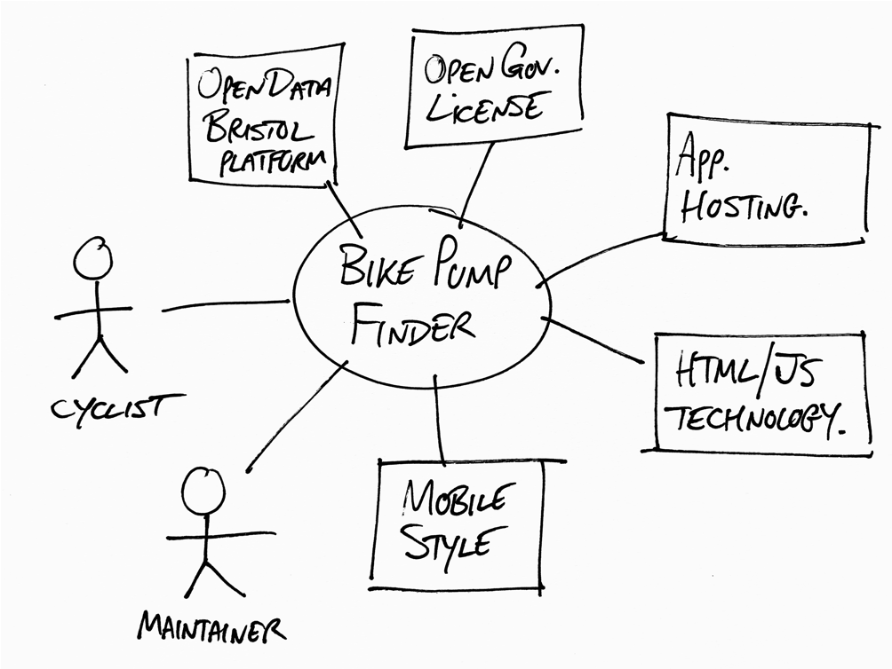

# Project Proposal: CARE 4 U
A wellbeing and scheduling app and local support app for unpaid carers, disabled people, and people who struggle with their mental health. The app is meant to help unpaid carers balance caring responsibilities with work, education, relationships and leisure and act as a support finder and a personalised daily activity planner for people who have mental health conditions and are disabled.

## Business Case

### Problem statement
 There are a lot of unpaid carers, disabled people, and people with mental health struggles may face different barriers having to organise their everyday activities while also having to balance work, life, relationships, and leisure. They may also find it hard to find local support services that are related to their needs because information is spread through different organisations and websites. These challenges can make every day planning harder, reduce time for rest and personal social activities, and create barriers to getting access to the support needed. The app will provide a platform that will combine personalised daily activity planning, basic wellbeing tools and a listing of local support services in Bristol and later more parts of the Uk. The selected data taken from the open data Bristol will be used to show information about unpaid care, disability, and health around the Bristol ward, which will help users of the app to learn more about the community needs
### Business benefits
There are several potential benefits for this app which include; Improving the Users wellbeing with the use of personalised planning for balancing out responsibilities between work, education, personal time, and social activities. The app could also help improve time management, helping the users plan their schedule much better, organise tasks, work time, study sessions, assignment due dates, and other commitments. The app would also help users get access to support groups, charity and community organisations helping them meet and bond with other people. The app will also make use of low cost software like HTML, CSS, and Javascript without needing complicated and expensive software to build.

### Options Considered
 Option one where nothing is done and just making use of the existing resources, this will have no development cost, and users can keep on using the app's existing planners and websites to access support, although with this option information 

 remains spread through different platforms, and the users must customise their own routines. Second option is making use of existing calendar and wellbeing apps, the advantage of this is that tools may already provide reminders, help with scheduling and tracking the Users mood, though with this option, the users may need different apps, and the information of the local support services may not be linked together. 

 Third option to consider would be to build an assigned repository to access and find local support, this would help unpaid carers, people with disabilities, and wellbeing services easier to find and access, although this option doesn't necessarily help the users personalise and schedule their day-to-day activities and responsibilities. Last option I may consider is to develop the app as a combined one including scheduling, wellbeing, getting access to local support, and inserting the data census, this would be helpful for the Users to use the app more easier without having to transfer to a third party app, although this option would require more development, testing, and continuous maintenance so that users can make the best use of it without issues

### Expected Risks
 Inaccurate or outdated service information where users may contact services that may have closed or moved locations. Users may have to enter sensitive information about their health or their care roles and responsibility, so privacy and data protection is needed. Users may run into technical difficulties where it may be hard to access their tasks, use filters, or some data may be lost. Some users may find it difficult to use, and some may find that it isn't relevant to what they need. People with visual, movement, and cognitive disabilities and impairments might not be able to use the app

## Project Scope
TODO: Scope of the System of Interest. Include a bullet list of things from your context diagram that are in scope.

